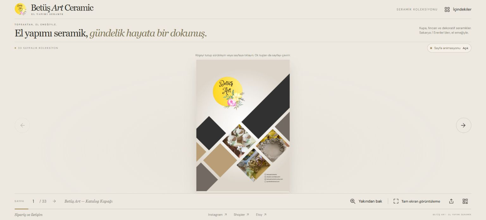

# Betüş Art Ceramic — İnteraktif Seramik Kataloğu

Orçun Kamil Kabadayı tarafından geliştirilen, Betüş Art Ceramic’in seramik ürünlerini dijital kitap deneyimiyle sunan web projesi.

**Canlı site: https://www.betusartceramic.com/**

## Özellikler

- 33 sayfalık, sayfa çevirme animasyonlu interaktif katalog.
- Mobil ve masaüstü okuma; sayfa numarasıyla geçiş ve detay görünümü.
- Katalog sayfasını paylaşma ve QR kod oluşturma.
- Shopier ve Etsy mağazalarına yönlendirme; sipariş/iletişim sayfası.
- Metadata, canonical adresler, sitemap, robots ve yapılandırılmış veri.
- Yerelde saklanan ürün görselleri ve tarayıcıda çalışan JavaScript.

## Çalıştırma

Bu depo yayındaki statik sürümü içerir. Klasörü bir statik HTTP sunucusuyla servis edip index.html dosyasını açın; framework derlemesi veya API anahtarı gerekmez. Ana dosyalar index.html, styles.css, app.js; katalog verileri assets/catalog-data.js içindedir.

Bu yazılım ödeme işlemini kendi sunucusunda gerçekleştirmez; mağaza bağlantılarına yönlendirir. Marka ve katalog görselleri Betüş Art Ceramic projesine aittir. Üçüncü taraf sayfa çevirme ve QR kütüphanelerinin lisansları vendor/ içinde korunur.

**Geliştirici:** [Orçun Kamil Kabadayı](https://www.orcunkamilkabadayi.com/)
